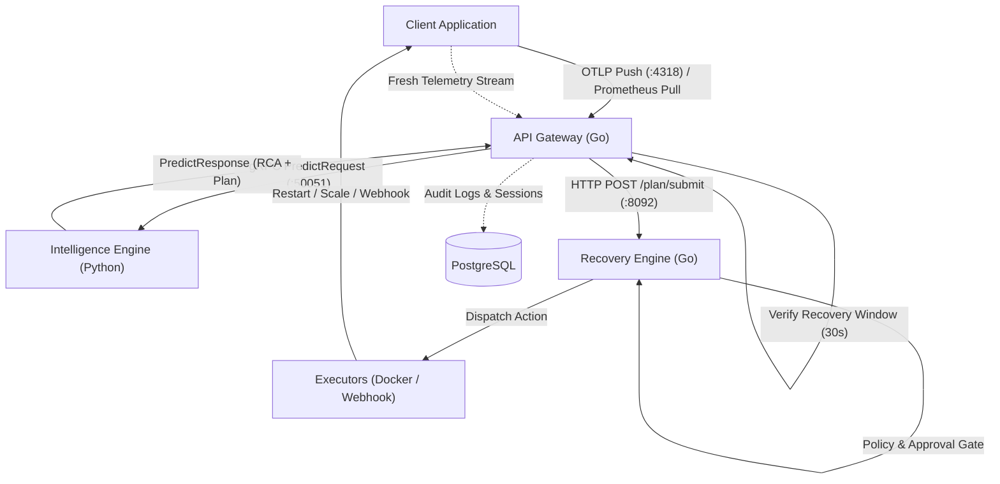
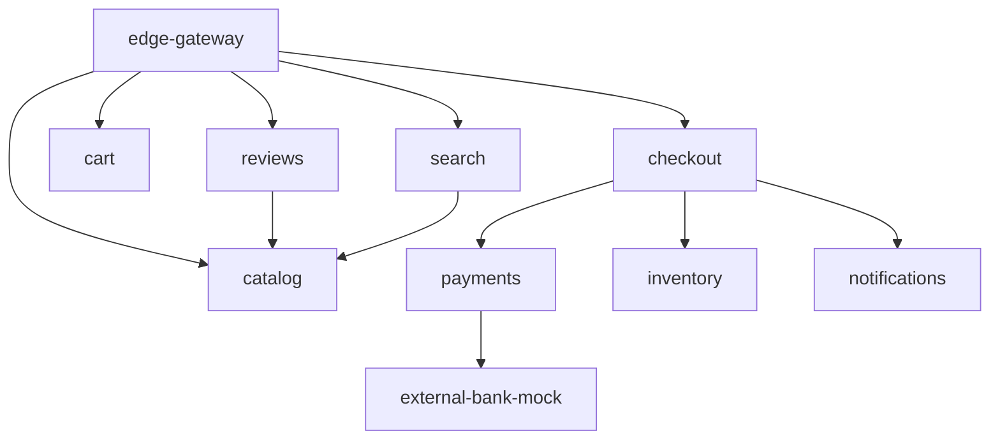

# Aegis

Aegis is an application-agnostic resilience control plane for distributed microservice meshes. It ingests OpenTelemetry and Prometheus signals, models runtime dependencies as a directed graph, detects service-level anomalies using configurable thresholds and rolling statistical baselines, isolates root causes with explainable evidence, and dispatches policy-gated recovery actions with post-action telemetry verification.

### What Problem It Solves
- **Cascading failure triage**: Pinpoints upstream root causes across complex dependency chains instead of triggering alerts on all downstream symptoms.
- **Incident remediation delay**: Automates dependency-ordered recovery planning, eliminating manual operational runbooks during production degradations.
- **Unsafe autonomous intervention**: Prevents destructive automated operations through strict role-based access control, risk policies, human approval gates, and empirical post-action telemetry verification.

---

## Architecture

The following diagram illustrates the Aegis runtime data flow from telemetry ingestion to closed-loop recovery verification:



### Services and Components

| Service | Language | Port(s) | Role |
|---|---|---|---|
| `api-gateway` | Go | `8000` (REST API), `4318` (OTLP HTTP) | Ingestion intake, service registry, topology state, auth/RBAC, SSRF proxy, and recovery coordination. |
| `python-ml` | Python | `50051` (gRPC) | Baseline anomaly detection, rolling statistical models, RCA ranking, Tarjan SCC graph analysis, and plan building. |
| `recovery-engine` | Go | `8092` (HTTP) | Recovery plan approval gating, action capability checks, and orchestrator dispatch execution. |
| `frontend` | TypeScript / React | `5173` (Dev) / `80` (Container) | Operator dashboard for topology exploration, active incidents, telemetry drill-down, and manual approvals. |
| `postgres` | SQL | `5432` | Relational persistence for user accounts, Argon2id credentials, active sessions, API keys, and append-only audit trails. |
| `chaos-engine` | Go | `8091` (HTTP) | Synthetic failure injection harness (CPU stress, latency injection, packet loss, process termination) for resilience testing. |
| `telemetry-agent` | Go | `8090` (HTTP) | High-throughput telemetry collector and streaming pipeline bridge to Kafka (full profile). |
| `kafka` | Java / Scala | `9092`, `29092` | Distributed event streaming broker for telemetry event buses (full profile). |
| `zookeeper` | Java | `2181` | Centralized cluster coordination service for Kafka (full profile). |
| `redis` | C | `6379` | In-memory key-value cache for distributed state and rate-limiting locks (full profile). |
| `gateway` *(Playground)* | Go | `8080` (HTTP) | Synthetic e-commerce edge gateway for demo environment. |
| `node-a` *(Playground)* | Go | `8081` (HTTP) | Synthetic microservice A (order processing) for demo mesh. |
| `node-b` *(Playground)* | Go | `8082` (HTTP) | Synthetic microservice B (payment gateway) for demo mesh. |
| `node-c` *(Playground)* | Go | `8083` (HTTP) | Synthetic microservice C (inventory tracking) for demo mesh. |
| `node-d` *(Playground)* | Go | `8084` (HTTP) | Synthetic microservice D (authorization / database backend) for demo mesh. |

---

## How Data Comes In

Aegis ingests operational signals through push and pull pipelines. Services are dynamically discovered from incoming signals; no pre-registration or static topology configuration is required.

### 1. OpenTelemetry (Push, Port 4318)
Applications send OTLP/HTTP telemetry (protobuf encoding) to port `4318`:
- Traces: `POST http://<aegis-host>:4318/v1/traces`
- Metrics: `POST http://<aegis-host>:4318/v1/metrics`
- Logs: `POST http://<aegis-host>:4318/v1/logs`

**Ingestion Rules:**
- **Service Identity**: Extracted from the `service.name` resource attribute.
- **Dependency Evidence**: Caller-to-dependency directed edges (`caller -> dependency`) are inferred when parent and child spans within the same batch map to distinct services.
- **Metric Fidelity**: Spans supply trace context and error rate signals. Latency percentiles, CPU, memory, database wait, cache misses, and queue depth must be exported as metrics.
- **Authentication**: When `AEGIS_INGEST_TOKEN` is configured, requests must supply the `x-aegis-token: <token>` header.

### 2. Prometheus (Pull, Scrape Interval)
The API Gateway contains a background scraper that polls standard Prometheus `/metrics` endpoints.
- **Discovery Sources**: Scrape targets can be supplied via `AEGIS_SCRAPE_TARGETS`, `AEGIS_SCRAPE_FILE_SD`, `AEGIS_PROM_URL`, `AEGIS_CONFIG_FILE`, Kubernetes annotations (`prometheus.io/scrape=true`), or Docker container labels (`aegis.scrape=true`).
- **Scrape Interval**: Governed by `AEGIS_SCRAPE_INTERVAL_SEC` (default: `2` seconds).
- **Metric Mapping**: Target metric names map to canonical signals (`cpu`, `memory`, `error_rate`, `latency`, `db_wait`, `cache_miss_rate`, `queue_depth`, `packet_loss`) via `configs/metric_mapping.yaml`.

### Data Semantics & Missing Data Handling
- **Failed Scrapes**: If a scrape fails, the service status becomes `unknown`. A failed scrape is **never converted to zero**.
- **Offline Services**: An explicit Prometheus scrape yielding `up{...} 0` marks the service `offline`.
- **Freshness Gate**: Telemetry older than `2 * AEGIS_SCRAPE_INTERVAL_SEC` is marked stale and excluded from live scoring.
- **Missing Telemetry**: Absent metrics remain null/missing. Aegis never marks a service healthy without fresh, observed evidence.

---

## How Decisions Are Made

Decision-making in Aegis is deterministic, evidence-based, and decoupled into discrete pipeline stages:

```mermaid
flowchart LR
    Ingest["Telemetry Ingestion"] --> Gate["Freshness & Incident Gate"]
    Gate --> Detection["Baseline Anomaly Detection"]
    Detection --> RCA["Root Cause Candidate Ranking"]
    RCA --> Impact["BFS Blast Radius (Potential Impact)"]
    Impact --> GraphOpt["Tarjan SCC + Kahn Recovery Ordering"]
    GraphOpt --> Rulebook["Rulebook & Risk Assessment"]
    Rulebook --> Approval["Approval Gate (Only LOW Auto-Approved)"]
    Approval --> Verification["4-State Post-Action Verification"]
```



### 1. Anomaly Detection
Telemetry windows are scored against configurable static thresholds and rolling robust statistical baselines (median and IQR). Cold-start windows rely on explicit threshold rules. Services with missing or stale telemetry are labeled `unknown` and excluded from scoring.

### 2. Incident Gate
To eliminate alert storms from transient metric spikes, an incident is triggered only when:
1. Failure probability meets or exceeds `AEGIS_INCIDENT_MIN_PROB` (default: `50.0`).
2. Telemetry is verified fresh (`time_since_ingest <= 2 * scrape_interval`).
3. Breaches are sustained across at least `AEGIS_INCIDENT_MIN_WINDOWS` consecutive evaluations (default: `2`).

### 3. Root-Cause Candidate Ranking
When an incident is active, candidates are ranked based on:
- Anomaly onset timestamps (earliest anomalous deviation).
- Metric deviation magnitude across canonical signals.
- Direct span and log error references.

Rankings provide explicit uncertainty disclosures (e.g., `"uncalibrated statistical ranking; causal attribution is inconclusive without correlated temporal or trace evidence"`). Topology reachability alone is never treated as causal proof.

### 4. BFS Blast Radius (Potential Impact Only)
Aegis traverses the dependency graph downstream from the root cause using Breadth-First Search (BFS).
- **Semantics**: Edges follow the `caller -> dependency` RPC convention.
- **Scope**: BFS reachability reports **potential blast radius only**. It indicates which upstream callers might experience degradation, not guaranteed failures.

### 5. Tarjan SCC & Kahn Recovery Ordering
Recovery ordering must heal dependencies before callers:
1. The sub-graph of affected services is extracted and reversed (`dependency -> caller`).
2. **Tarjan's Strongly Connected Components (SCC)** algorithm identifies cyclic dependency groups and feedback loops.
3. The graph is condensed into a Directed Acyclic Graph (DAG) of SCC super-nodes.
4. **Kahn's Algorithm (1962)** computes the topological sort on the condensed DAG.

### 6. `blocked_topology` for Cycles
If an affected subgraph contains a cycle (an SCC with multiple nodes or a self-loop), sequential ordering is mathematically undefined.
- Aegis will **not** flatten the cycle into a synthetic sequence.
- The planner halts sequential generation, sets plan status to `blocked_topology`, isolates the cyclic groups, assigns `HIGH` risk, and requires manual operator intervention.

### 7. Rulebook and Action Mapping
The rulebook maps diagnosed fault families to recovery actions and validates that the action target is strictly within the set: `{root_cause} U {direct dependencies/callers}`.

| Fault Family | Primary Recommended Action | Risk Level | Requires Approval |
|---|---|---|---|
| `crash` / `kill_service` | `restart` | `HIGH` | Yes |
| `cpu_stress` / `cpu_saturation` | `scale` | `LOW` | No |
| `memory_leak` | `restart` | `HIGH` | Yes |
| `db_contention` / `slow_query` | `increase_pool` | `LOW` | No |
| `cache_down` | `flush_cache` | `MEDIUM` | Yes |
| `latency` / `packet_loss` | `reroute_traffic` | `MEDIUM` | Yes |
| `mq_lag` / `queue` | `scale` | `LOW` | No |
| `thread_exhaustion` | `scale` | `LOW` | No |

### 8. Approval Gate
- **Auto-Approval**: **Only `LOW` risk actions are automatically approved and executed.**
- **Manual Gate**: `MEDIUM` and `HIGH` risk actions are held in `pending` status until an authorized `operator` or `admin` approves them via `POST /api/recovery/approve`.

### 9. The 4 Plan States
Every recovery plan transitions through explicit lifecycle states:
1. `recommended`: Generated by the Python engine based on observed evidence.
2. `approved`: Approved automatically (for `LOW` risk) or manually authorized by an operator.
3. `attempted` (or `dispatched`): Forwarded to the orchestrator adapter or customer webhook.
4. `verified`: Post-action telemetry within the 30-second verification window confirms metric recovery (`status == healthy`, `error_rate` and `latency` below threshold). If fresh post-action evidence is missing or fails thresholds, the status remains `Unverified` (never assumed successful).

---

## Recovery Executors

Aegis supports execution through an orchestrator adapter or customer HTTP webhooks. The table below identifies which operations execute real changes versus those that are currently log-only simulation stubs:

| Executor Type | Action | Implementation Status | Technical Behavior |
|---|---|---|---|
| **Docker Adapter** | `restart` | **Real** | Invokes `docker restart <container>` via local Docker CLI. |
| **Docker Adapter** | `scale` | **Real** | Invokes `docker compose up -d --scale <service>=<replicas> --no-recreate`. |
| **Docker Adapter** | `reroute_traffic` | **Log-only** | Writes log entry; returns `nil` without modifying proxy routes. |
| **Docker Adapter** | `flush_cache` | **Log-only** | Writes log entry; returns `nil` without flushing Redis/cache. |
| **Docker Adapter** | `increase_pool` | **Log-only** | Writes log entry; returns `nil` without resizing DB connection pool. |
| **Kubernetes Adapter** | `restart` | **Log-only** | Writes log entry; does not communicate with Kubernetes API. |
| **Kubernetes Adapter** | `scale` | **Log-only** | Writes log entry; does not scale Deployment resources. |
| **Customer Webhook** | `RESTART` | **Real** | Sends HTTP `POST` to configured webhook endpoint (e.g. `/admin/restart`). |
| **Customer Webhook** | `SCALE_UP` | **Real** | Sends HTTP `POST` with `?replicas=N` query parameter. |
| **Customer Webhook** | `FLUSH_CACHE` | **Real** | Sends HTTP `POST` to configured webhook endpoint (e.g. `/admin/flush-cache`). |
| **Customer Webhook** | `INCREASE_POOL` | **Real** | Sends HTTP `POST` with `?n=N` query parameter. |

> Customer Webhook execution supports configurable timeouts, exponential retries, and passes authentication tokens via the `X-Admin-Token` header.

---

## Security and Safety

Aegis enforces enterprise security controls across authentication, network boundaries, and execution gates:

- **Role-Based Access Control (RBAC)**:
  - `Viewer` (Level 1): Read-only access to topology, metrics, predictions, and audit logs.
  - `Operator` (Level 2): Viewer access + plan approval/rejection and low/medium-risk execution.
  - `Admin` (Level 3): Full control + high-risk execution, chaos injection, user role management, and machine API key creation.
  - Server-enforced signup: Initial user or `AEGIS_BOOTSTRAP_ADMIN_EMAIL` receives `admin`; all subsequent registrations default to `viewer`.
- **Argon2id Password Hashing**: Complies with RFC 9106 ($m=64\text{ MB}$, $t=1$, $p=2$, 16-byte CSPRNG salt, constant-time verification).
- **Account Lockout & Sessions**: 5 consecutive failed login attempts lock the account for 15 minutes (HTTP `429`). Active sessions are revoked immediately in PostgreSQL upon logout.
- **Machine API Keys**: Prefixed `aegis_ak_<prefix>`, hashed with SHA-256 before storage in PostgreSQL, and revealed only once upon creation.
- **Ingestion Token**: When `AEGIS_INGEST_TOKEN` is set, OTLP ingestion requires the `x-aegis-token` header.
- **SSRF Protection (`ssrf.go`)**: All outbound URLs (Prometheus scrape endpoints, webhooks, health checks) are validated against private, loopback, and cloud metadata ranges (`127.0.0.0/8`, `10.0.0.0/8`, `172.16.0.0/12`, `192.168.0.0/16`, `169.254.0.0/16`, `metadata.google.internal`, `::1`, `fc00::/7`). Follows at most 5 redirects, re-validating each hop, with a 1 MB response cap.
- **Idempotency Keys**: Action execution requests accept an `Idempotency-Key` header or payload field. Duplicate submissions return the recorded execution from PostgreSQL without re-executing.
- **Dry-Run by Default**: Environments start in dry-run mode (`X-Dry-Run: true`). Actions validate policy and blast radius without executing changes until explicit live execution is enabled.

---

## Quick Start

### 1. Environment Setup
Clone the repository and copy the example environment configuration:

```bash
cp .env.example .env
```

Edit `.env` and set secure credentials:
```bash
POSTGRES_PASSWORD="SetAStrongDatabasePasswordHere!"
AEGIS_BOOTSTRAP_ADMIN_EMAIL="admin@enterprise.io"
AEGIS_BOOTSTRAP_ADMIN_PASSWORD="SetAStrongAdminPasswordHere#2026!"
```

### 2. Start Core Stack
Run the core control plane using Docker Compose:

```bash
docker compose --profile core up --build -d
```

Core endpoints:
- **API Gateway & Control Plane**: `http://localhost:8000`
- **OTLP HTTP Ingestion**: `http://localhost:4318`
- **Python ML gRPC Service**: `localhost:50051`
- **Recovery Engine**: `http://localhost:8092`
- **Web Dashboard**: `http://localhost:5173`

To enable the real Docker executor (mounting the Docker daemon socket):
```bash
docker compose -f docker-compose.yml -f docker-compose.recovery-docker.yml --profile core up --build -d
```

### 3. How to Connect an Application

#### Option A: OpenTelemetry Push
Configure the OpenTelemetry SDK in your application:
```bash
export OTEL_EXPORTER_OTLP_ENDPOINT="http://localhost:4318"
export OTEL_EXPORTER_OTLP_PROTOCOL="http/protobuf"
export OTEL_SERVICE_NAME="order-service"
export OTEL_METRICS_EXPORTER="otlp"
export OTEL_TRACES_EXPORTER="otlp"
export OTEL_LOGS_EXPORTER="otlp"
export OTEL_METRIC_EXPORT_INTERVAL="10000"
```

#### Option B: Prometheus Pull
Expose `/metrics` on your application and set the scrape target in `.env`:
```bash
AEGIS_SCRAPE_TARGETS="order-service:8080/metrics,payment-service:8081/metrics"
AEGIS_SCRAPE_INTERVAL_SEC=2
```

### 4. How to Run Tests

#### Go Unit and Integration Tests
Run from the `go-services/` directory:
```bash
cd go-services
go test ./... -v
```

#### Python Unit and Graph Tests
Run pytest from the repository root:
```bash
python -m pytest tests/python-ml/ -q
```

### 5. Demo Walkthrough: ShopKart Mesh
Github repo : https://github.com/jhanvi857/ShopKart

ShopKart is an onboarding fixture modeling a 10-node e-commerce microservices mesh (`configs/topologies/shopkart_onboarding.yaml`):



1. **Start Stack with ShopKart Topology**:
   ```bash
   AEGIS_TOPOLOGY_FILE=./configs/topologies/shopkart_onboarding.yaml docker compose --profile core up --build -d
   ```
2. **Login to the Dashboard**:
   Open `http://localhost:5173` and authenticate with `admin@enterprise.io` and your bootstrap password.
3. **Simulate a Fault**:
   Inject high CPU stress into `catalog` via the Chaos Engine API or dashboard:
   ```bash
   curl -X POST http://localhost:8000/api/chaos/inject \
     -H "Content-Type: application/json" \
     -H "Authorization: Bearer <token>" \
     -d '{"target_service_id": "catalog", "fault_type": "cpu_stress", "duration_seconds": 60}'
   ```
4. **Observe Incident Gate & Root Cause**:
   - The sustained breach gate activates after 2 consecutive breach windows.
   - The Python ML engine diagnoses `catalog` as root cause with `cpu_stress` fault family.
   - Outgoing BFS marks callers (`edge-gateway`, `search`, `reviews`) as potential blast radius.
5. **Review and Approve Recovery**:
   - The engine generates a recovery plan (`scale` on `catalog`).
   - Because `scale` is a `LOW` risk action, it is auto-approved, or held if configured for manual approval.
6. **Verify Resolution**:
   - The executor scales the service.
   - The 30-second verification window confirms CPU drops below 85% with fresh incoming telemetry, transitioning the status to `Verified`.

---

## Repository Structure

```text
Aegis/
├── configs/          # Topology definitions, metric mappings, and detector threshold configurations.
├── dataset/          # RCAEval benchmark dataset captures and preparation scripts.
├── deploy/           # Production deployment manifests and Docker specifications.
├── docs/             # Technical specifications, architecture audits, security rules, and benchmark results.
├── examples/         # Sample application instrumentation fixtures and topology examples.
├── frontend/         # React/Vite web dashboard for topology visualization and recovery approvals.
├── go-services/      # Go backend control plane (api-gateway, recovery-engine, chaos-engine, adapters).
├── notebooks/        # Jupyter notebooks for offline analysis and evaluation reproduction.
├── proto/            # Protocol Buffer definitions for telemetry, graphs, prediction, and recovery.
├── python-ml/        # Python intelligence engine (anomaly detection, baselines, graph algorithms, planner).
├── scripts/          # Automation scripts for Protobuf stub generation and benchmarking.
└── tests/            # Automated test suites for Go, Python, and frontend modules.
```

---

## Results

Evaluation metrics are reported strictly from held-out experiments recorded in `docs/results.md` on the RCAEval RE1 benchmark:

- **Benchmark Dataset**: RCAEval RE1 (`RE1-OB`, `RE1-SS`, `RE1-TT` microservice systems; 375 incident cases).
- **Pre-registered Selection Protocol**: Strict Leave-One-System-Out (LOSO) cross-validation. A candidate trained model is accepted only if its mean strict-LOSO F1 beats the `ServiceDetector` baseline by $> 1$ standard deviation ($0.475 + 0.284 = 0.759$).

### Strict Labels Benchmark (Leave-One-System-Out)
*Evaluates only root-cause service windows post-injection (634,886 windows across 375 cases):*

| Model | Precision | Recall | F1 Score | PR-AUC | RCA Top-1 | RCA Top-3 |
|---|---:|---:|---:|---:|---:|---:|
| **ServiceDetector** *(Baseline)* | 0.347 ± 0.264 | **0.981 ± 0.010** | **0.475 ± 0.284** | 0.421 ± 0.278 | 0.149 ± 0.020 | 0.400 ± 0.204 |
| **Random Forest** | **0.461 ± 0.460** | 0.557 ± 0.369 | 0.401 ± 0.313 | **0.466 ± 0.401** | **0.363 ± 0.408** | **0.483 ± 0.337** |
| **XGBoost** | 0.320 ± 0.391 | 0.619 ± 0.403 | 0.353 ± 0.345 | 0.460 ± 0.329 | 0.352 ± 0.234 | 0.536 ± 0.279 |
| **Isolation Forest** | 0.153 ± 0.146 | 0.942 ± 0.093 | 0.240 ± 0.198 | 0.608 ± 0.344 | 0.416 ± 0.152 | 0.643 ± 0.111 |
| **Always Positive** | 0.049 ± 0.029 | 1.000 ± 0.000 | 0.092 ± 0.053 | 0.049 ± 0.029 | 0.107 ± 0.101 | 0.307 ± 0.272 |

### Selection Decision & Operational Choice
- **Protocol Outcome**: Random Forest (strict-LOSO F1: `0.401`) did **not** exceed the pre-registered threshold (`0.759`) over `ServiceDetector` (`0.475 ± 0.284`).
- **Deployment Strategy**: F1 at fixed thresholds disproportionately favors high positive-rate detectors on class-imbalanced datasets. Random Forest demonstrates superior Precision-Recall AUC (`0.466`) and balanced precision across held-out systems. Random Forest is deployed as the operational model when feature coverage is met, with `ServiceDetector` retained as the guaranteed fallback engine.
- **Evaluation Scope**: Random Forest was trained on RE1-OB/SS/TT; generalization to unseen production applications remains unverified.
- **Trace-Based RCA Validation**: RE2-OB trace payloads are absent from the local dataset; trace-based RCA is implemented as supporting evidence in code, but is **not validated** against labeled ground truth. No trace RCA accuracy is claimed.

---

## Known Limits and Future Work

### Known Limitations
1. **Process-Local Rolling Baselines**: The Python detector maintains rolling baseline statistics in memory. State is lost on process restart and does not persist across replicas.
2. **Uncalibrated RCA Ranking**: Root-cause scores represent heuristic and statistical discrepancy rankings, not calibrated posterior failure probabilities.
3. **Incomplete Adapter Realizations**: The Docker adapter executes real container restarts and compose scaling, but cache invalidation, traffic rerouting, and pool scaling are log-only stubs. The Kubernetes adapter is entirely a log stub.
4. **Single-Node In-Memory Telemetry**: The Go API gateway stores recent telemetry in bounded in-memory circular buffers, lacking horizontal replication or a durable time-series database backend.
5. **Trace RCA Ground Truth**: Trace-based evidence ranking cannot be formally evaluated locally due to the absence of public RE2-OB trace dataset files.

### Future Work
- Integrate a distributed time-series backend (e.g. ClickHouse or VictoriaMetrics) for long-term telemetry retention.
- Implement a Kubernetes CRD operator supporting real pod evictions, ingress traffic shifts, and HPA target scaling.
- Implement distributed checkpointing for Python rolling baseline statistics using Redis or PostgreSQL.
- Incorporate formal causal discovery and invariant causal prediction algorithms for provable root-cause attribution.
- Evaluate trace-based RCA against full distributed trace benchmark corpora.
